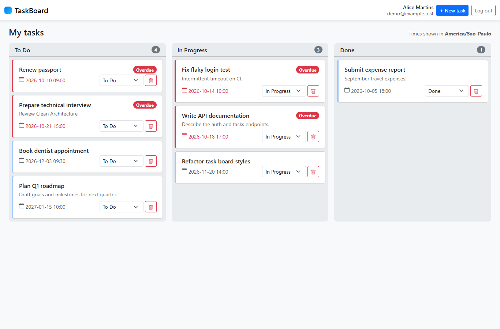

# TaskBoard

A personal Kanban task manager: a **.NET 10 Minimal API** (Clean Architecture, EF Core + SQLite, JWT, built test-first with xUnit) and an **Angular 21 LTS** SPA (signals, NSwag-generated clients, Bootstrap 5, CDK drag-and-drop).

> **User story (US-001):** As a registered user, I want to securely create, organize, update and track my personal tasks on a Kanban board, so I can manage my responsibilities, monitor progress and spot overdue tasks.
> Full acceptance criteria: [Documents/USER-STORY.md](Documents/USER-STORY.md).



## Quick start

**Prerequisites:** .NET SDK 10.0.402+ (pinned in `global.json`), Node.js 22 (npm 10+). No database server is needed.

```bash
# 1. API → http://localhost:5080 (creates and seeds Backend/src/TaskBoard.Api/taskboard.db on first run)
cd Backend
dotnet run --project src/TaskBoard.Api

# 2. Web app → http://localhost:4200 (second terminal; /api is proxied to the API)
cd Frontend
npm ci
npm start
```

Open http://localhost:4200 and sign in with a demo account:

| User | Email | Password | Time zone |
|---|---|---|---|
| Alice Martins | `demo@example.test` | `DemoPass123!` | America/Sao_Paulo |
| Bob Tanaka | `bob@example.test` | `DemoPass123!` | Asia/Tokyo |

The demo credentials are **for local demos only**. The two users have separate tasks, so you can show that each user only sees their own. Some seeded due dates are fixed before 2026-10-21, so those tasks show as overdue.

## Tests

```bash
cd Backend  && dotnet test     # 170 xUnit tests: domain (33), application (65), SQLite infrastructure (22), HTTP endpoints (50)
cd Frontend && npm test        # 53 Vitest specs: stores, interceptors, guards, forms, board
```

The backend was built **RED → GREEN → REFACTOR**. Each step is a separate git commit (`test(red): …`, `feat(green): …`, `refactor: …`; see `git log --oneline`). [Backend/docs/ai-assisted-development.md](Backend/docs/ai-assisted-development.md) records why each test failed and what made it pass.

## Architecture

```
Backend/
  src/TaskBoard.Domain          Entities (User, TaskItem), invariants, overdue rule — no dependencies
  src/TaskBoard.Application     Use cases, Result pattern, FluentValidation validators, ports (repositories, token, password, current user)
  src/TaskBoard.Infrastructure  EF Core + SQLite (migrations, HasData seed), repositories, PasswordHasher, JWT
  src/TaskBoard.Api             Minimal API endpoints, ApiResult envelope, auth, error handling, OpenAPI
  tests/…                       One xUnit project per layer
Frontend/
  src/app/core                  NSwag clients (generated), AuthStore, interceptors, guards, error modal
  src/app/features/auth         /login, /register
  src/app/features/tasks        /tasks board: TasksStore (signals), columns, cards, task dialog
```

Dependencies point inward: **Api → Application → Domain**, and **Infrastructure → Application**. Api references Infrastructure only to wire up dependency injection. The rationale for each decision is in [Backend/docs/architecture-decisions.md](Backend/docs/architecture-decisions.md).

### API

| Method | Route | Auth | Success | Errors |
|---|---|---|---|---|
| GET | `/api/public/ping` | anonymous | 200 | — |
| POST | `/api/auth/register` | anonymous | 201 | 400, 409 |
| POST | `/api/auth/login` | anonymous | 200 `{ accessToken, expiresAt, user }` | 400, 401 |
| GET | `/api/auth/me` | bearer | 200 | 401 |
| GET | `/api/tasks` | bearer | 200 (overdue first) | 401 |
| GET | `/api/tasks/{id}` | bearer | 200 | 401, 404 |
| POST | `/api/tasks` | bearer | 201 + `Location` | 400, 401 |
| PUT | `/api/tasks/{id}` | bearer | 200 | 400, 401, 404 |
| PATCH | `/api/tasks/{id}/status` | bearer | 200 | 400, 401, 404 |
| DELETE | `/api/tasks/{id}` | bearer | 204 (no body) | 401, 404 |

- **Response envelope.** Every response that has a body uses one shape, `ApiResult`: `{ "isSuccess": true, "data": {…}, "error": null }` or `{ "isSuccess": false, "error": { "code", "message", "validationErrors"? } }`. This includes JWT 401s, unknown routes, malformed JSON and unhandled 500s (500s never include a stack trace).
- **Tasks.** `TaskDto` = `id, title, description, status (todo | inProgress | done), dueDateUtc, dueDateLocal, isOverdue`.
- **Ownership.** A task that belongs to another user returns **404**, not 403, so task ids can't be probed.
- **Try it.** OpenAPI is served at http://localhost:5080/openapi/v1.json (Development only). Ready-made requests are in [`Backend/src/TaskBoard.Api/TaskBoard.Api.http`](Backend/src/TaskBoard.Api/TaskBoard.Api.http).

### Time zones and overdue tasks

- **Storage.** Due dates are stored in **UTC** (BR-008).
- **Input.** The client sends `dueDate` as **local wall-clock time without an offset** (`"2026-10-21T15:00"`). The API converts it using the user's configured IANA time zone, so in São Paulo it becomes `2026-10-21T18:00:00Z` (Scenario 21). Values with `Z` or an offset are rejected.
- **Output.** Responses carry both the UTC instant (`dueDateUtc`) and the wall-clock time in the user's zone (`dueDateLocal`). The browser therefore does no time-zone math, and the board shows the user's configured zone even if the device is set to another one.
- **Overdue.** `isOverdue = status != done && dueDateUtc < now (UTC)` (BR-006). It is computed by the server using an injected `TimeProvider`.
- **Daylight-saving edge cases.**
  - A local time that doesn't exist (inside a DST gap) is rejected with a field error.
  - An ambiguous local time (DST fall-back) resolves to standard time.
  - When an edit leaves the due date unchanged, the stored instant is kept, so it can't silently shift by an hour.

## Database

The database is a file-based **SQLite** database: `Backend/src/TaskBoard.Api/taskboard.db`. The path is resolved against the API's content root, so `dotnet run`, `dotnet ef` and IDEs all use the same file.

- **Schema and seed.** Both are created by **EF Core Code First migrations**. The two demo users and their tasks are seeded with `HasData`, so the seed is part of the `SeedDemoData` migration.
- **Applying migrations.** In Development the API applies pending migrations on startup. Elsewhere, run them explicitly:
  ```bash
  cd Backend
  dotnet tool restore                      # dotnet-ef 10.0.13 (local tool manifest)
  dotnet ef database update --project src/TaskBoard.Infrastructure --startup-project src/TaskBoard.Api
  ```
- **Persistence.** Data survives restarts. The seed runs once per database, so restarting never duplicates it or overwrites your changes.
- **Reset to the demo data.** Stop the API, delete `taskboard.db*`, and start the API again.
- **Schema rules.** Emails have a unique index (and are stored lower-cased). `TaskItems.UserId` is a required foreign key with `Restrict` delete. Status is stored as text.

## Regenerating the API client

The Angular app uses **NSwag-generated** clients (`Frontend/src/app/core/api/generated/`, committed, never edited by hand). After changing the API contract:

```bash
# with the API running on http://localhost:5080
cd Frontend && npm run generate:api
```

The API emits **OpenAPI 3.0** rather than .NET 10's default 3.1, because NSwag 14 does not fully support 3.1. DTO schemas are closed (`additionalProperties: false`), so the generated TypeScript interfaces are strict.

## How the brief was interpreted

| Brief | Implementation |
|---|---|
| "ASP.NET MVC, Web API" | ASP.NET Core **Minimal API** plus an Angular SPA. This satisfies the Web API and separate-frontend requirements, but it is not server-rendered MVC. |
| "A second API" for users | A second **endpoint module** (`/api/auth`) in the same host, not a separate deployable. Anonymous routes (`/api/public/ping`, register, login) and protected routes (`/api/auth/me`, `/api/tasks/*`) show both access levels. |
| Database or other storage, users and data separated | SQLite with `Users` and `TaskItems` tables and a real foreign key |
| Task system example | Used as the exercise's actual use case |
| CLAUDE.md defaults vs. US-001 | **US-001 wins**: title ≤ 50, description ≤ 400, required UTC due date, user name and time zone (recorded in §0 of both CLAUDE.md files) |
| Seed | **Code First `HasData` in a migration.** As a result, the demo accounts exist wherever these migrations run. Remove them before using this schema in production. |

## Security notes

- **Passwords.** Hashed with ASP.NET Core Identity's `PasswordHasher` (PBKDF2, salted). Never stored in plaintext or returned by the API.
  - Policy: 8–100 characters, with upper- and lower-case letters, a digit and a symbol. Frontend and backend enforce the same rules.
- **Login failures.** An unknown email and a wrong password get the same 401 with comparable timing, so the response doesn't reveal which accounts exist.
- **JWT.**
  - HS256, validated for issuer, audience, signature and lifetime, with a 30-second clock skew. Default lifetime is 60 minutes.
  - Configuration is checked at startup; a missing or too-short key (under 32 bytes) fails fast.
  - The development key lives in `appsettings.Development.json`. For any other environment, set `Jwt__SigningKey` through user-secrets or an environment variable.
- **Server-trusted identity.** The owner of a task always comes from the token (`sub`); request bodies cannot set `UserId`. A token whose user no longer exists (e.g. after a database reset) gets a 401 instead of a foreign-key failure.
- **Token storage in the SPA.** This demo keeps the token in **sessionStorage**, where JavaScript can read it, so it is exposed to XSS. A production app should prefer an HttpOnly-cookie or BFF approach with refresh tokens.
- **Session handling.**
  - An expired or invalid session triggers a 401, which signs the user out and shows a "Session expired" modal.
  - A 401 from the login request itself is shown as invalid credentials, so it can't cause a redirect loop.
  - Post-login `returnUrl`s are restricted to relative app paths.
- **CORS.** None is configured: in development the Angular proxy makes the API same-origin. A split-origin deployment would need a CORS policy restricted to the SPA's origin.

## Known limitations

- **Stale overdue flag.** `isOverdue` is computed when tasks are loaded. A board left open doesn't flip a card to overdue until the next load or action.
- **Concurrent edits.** The last write wins; there is no concurrency token.
- **Card order.** Cards keep a fixed order within a column (overdue first, then by due date). Same-column drag reordering is disabled because nothing in the model stores an order.
- **Sessions.** There are no refresh tokens. Users sign in again when the token expires.
- **Seeded dates.** The demo data uses fixed dates around 2026-10-21, so more tasks become overdue as time passes.
- **npm bug.** npm 10.9.x can fail `npm install` in a fresh clone with `Cannot read properties of null (reading 'edgesOut')`, an npm arborist bug. `npm ci` (which uses the committed lockfile) works, as does npm ≥ 11.
